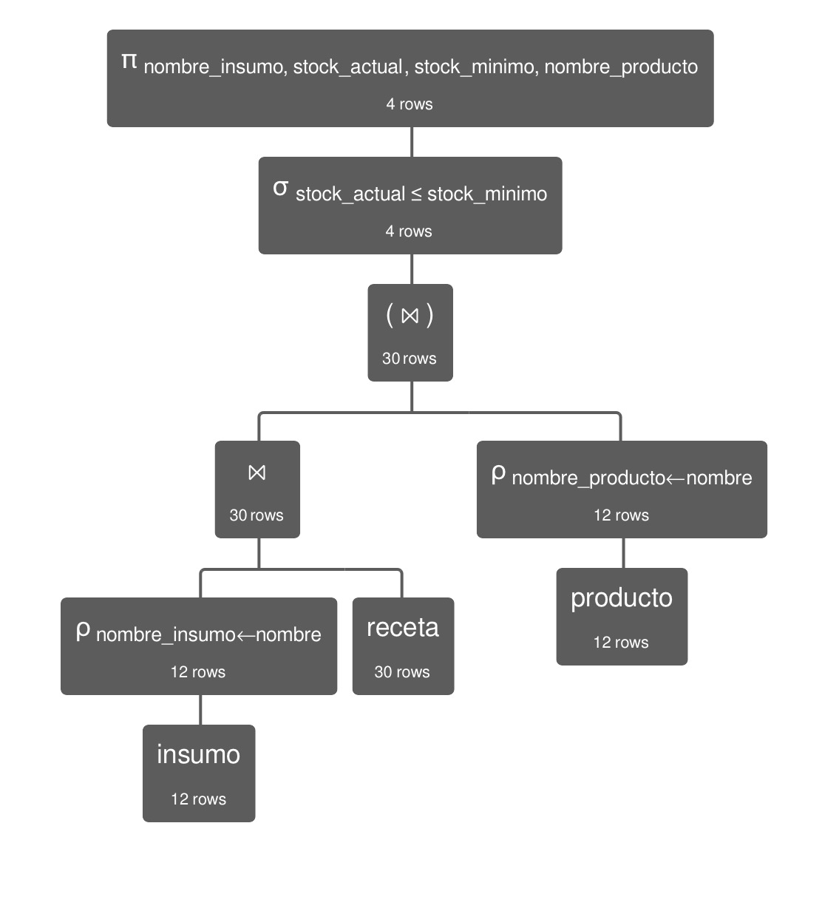
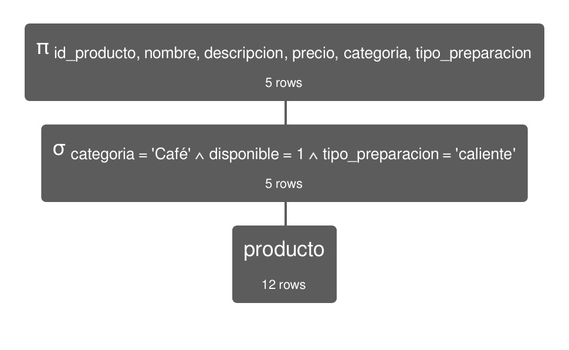
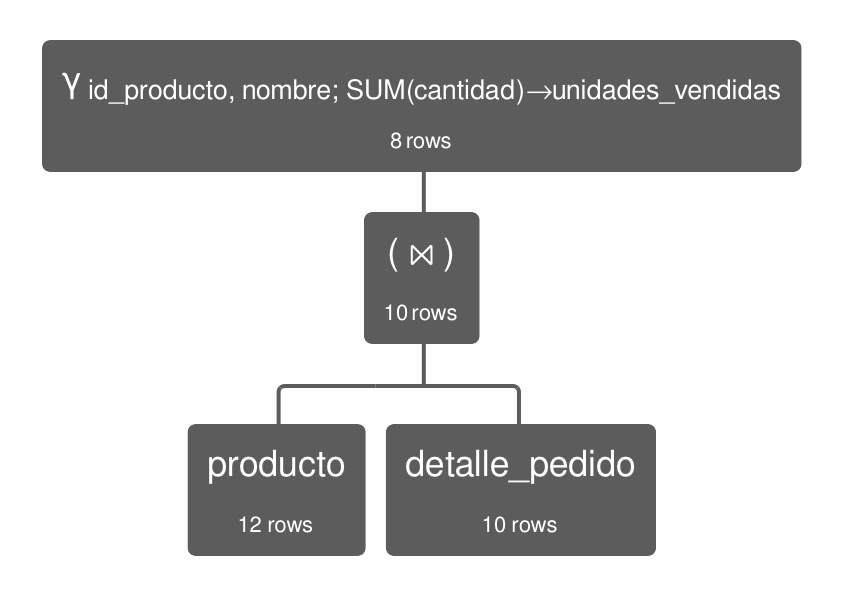

# Álgebra relacional de los 3 SELECT

Las consultas SELECT del proyecto (`queries/03`, `04` y `05`) expresadas en álgebra relacional.
Los resultados esperados corresponden a los datos de prueba originales (`migrations/002_seed.sql`),
que son los mismos que trae el archivo de RelaX `algebra_relacional/brookies.relax.txt`.

> **Verificado en RelaX** (25/09/2026): las 3 expresiones se probaron en https://dbis-uibk.github.io/relax/
> cargando `brookies.relax.txt` como grupo de datos. El resultado de cada una calzó exacto con las
> tablas de abajo. Los árboles de ejecución quedan como captura junto a cada consulta.
> El álgebra relacional trabaja con conjuntos: el `ORDER BY` del SQL no forma parte de la expresión.

Símbolos: π proyección · σ selección · ⋈ reunión natural · ρ renombre · γ agrupación.

---

## Consulta 03 · Productos filtrados (sin JOIN)

```sql
SELECT id_producto, nombre, descripcion, precio, categoria, tipo_preparacion
FROM producto
WHERE categoria = 'Café' AND disponible = TRUE AND tipo_preparacion = 'caliente';
```

Notación matemática:

```
π id_producto, nombre, descripcion, precio, categoria, tipo_preparacion
  ( σ categoria = 'Café' ∧ disponible = 1 ∧ tipo_preparacion = 'caliente' (producto) )
```

En RelaX:

```
pi id_producto, nombre, descripcion, precio, categoria, tipo_preparacion (sigma categoria = 'Café' and disponible = 1 and tipo_preparacion = 'caliente' (producto))
```

Árbol y resultado verificados en RelaX:



Resultado esperado:

| id_producto | nombre | descripcion | precio | categoria | tipo_preparacion |
| --- | --- | --- | --- | --- | --- |
| 1 | Espresso | Shot de espresso | 1800 | Café | caliente |
| 2 | Americano | Espresso alargado con agua caliente | 2200 | Café | caliente |
| 3 | Latte | Espresso con leche entera texturizada | 2900 | Café | caliente |
| 4 | Cappuccino | Espresso con leche y espuma | 2900 | Café | caliente |
| 5 | Latte de avena | Espresso con leche de avena | 3200 | Café | caliente |

---

## Consulta 04 · Productos más vendidos (JOIN + agrupación)

```sql
SELECT p.id_producto, p.nombre, SUM(d.cantidad) AS unidades_vendidas
FROM producto p
JOIN detalle_pedido d ON d.id_producto = p.id_producto
GROUP BY p.id_producto, p.nombre;
```

`producto` y `detalle_pedido` solo comparten el atributo `id_producto`, así que la reunión natural (⋈)
equivale al JOIN del SQL.

Notación matemática:

```
γ id_producto, nombre ; SUM(cantidad) → unidades_vendidas ( producto ⋈ detalle_pedido )
```

En RelaX:

```
gamma id_producto, nombre; sum(cantidad) -> unidades_vendidas (producto join detalle_pedido)
```

Árbol y resultado verificados en RelaX:



Resultado esperado (en el SQL va ordenado de mayor a menor):

| id_producto | nombre | unidades_vendidas |
| --- | --- | --- |
| 3 | Latte | 3 |
| 11 | Brookie clásico | 2 |
| 4 | Cappuccino | 2 |
| 1 | Espresso | 2 |
| 6 | Cold brew | 1 |
| 8 | Galleta de chocolate | 1 |
| 9 | Galleta vegana de avena | 1 |
| 7 | Matcha | 1 |

---

## Consulta 05 · Insumos en stock crítico y productos que los usan (JOIN de 3 tablas)

```sql
SELECT DISTINCT i.nombre AS insumo, i.stock_actual, i.stock_minimo, p.nombre AS producto
FROM insumo i
JOIN receta r   ON r.id_insumo   = i.id_insumo
JOIN producto p ON p.id_producto = r.id_producto
WHERE i.stock_actual <= i.stock_minimo;
```

`insumo` y `producto` tienen ambos un atributo `nombre`. Como la reunión natural también uniría por
los atributos con el mismo nombre, primero se renombran (ρ) para que solo se una por las llaves
(`id_insumo` e `id_producto`). La proyección elimina duplicados, igual que el `DISTINCT`.

Notación matemática:

```
π nombre_insumo, stock_actual, stock_minimo, nombre_producto
  ( σ stock_actual ≤ stock_minimo
      ( ρ nombre_insumo ← nombre (insumo)  ⋈  receta  ⋈  ρ nombre_producto ← nombre (producto) ) )
```

En RelaX:

```
pi nombre_insumo, stock_actual, stock_minimo, nombre_producto (sigma stock_actual <= stock_minimo ((rho nombre_insumo <- nombre (insumo)) join receta join (rho nombre_producto <- nombre (producto))))
```

Árbol y resultado verificados en RelaX:



Resultado esperado (las columnas `insumo` y `producto` del SQL aparecen aquí como `nombre_insumo` y `nombre_producto`):

| insumo | stock_actual | stock_minimo | producto |
| --- | --- | --- | --- |
| Huevos | 20 | 24 | Brookie clásico |
| Huevos | 20 | 24 | Galleta de chocolate |
| Huevos | 20 | 24 | Galleta sin gluten de almendras |
| Matcha en polvo | 90 | 100 | Matcha |
